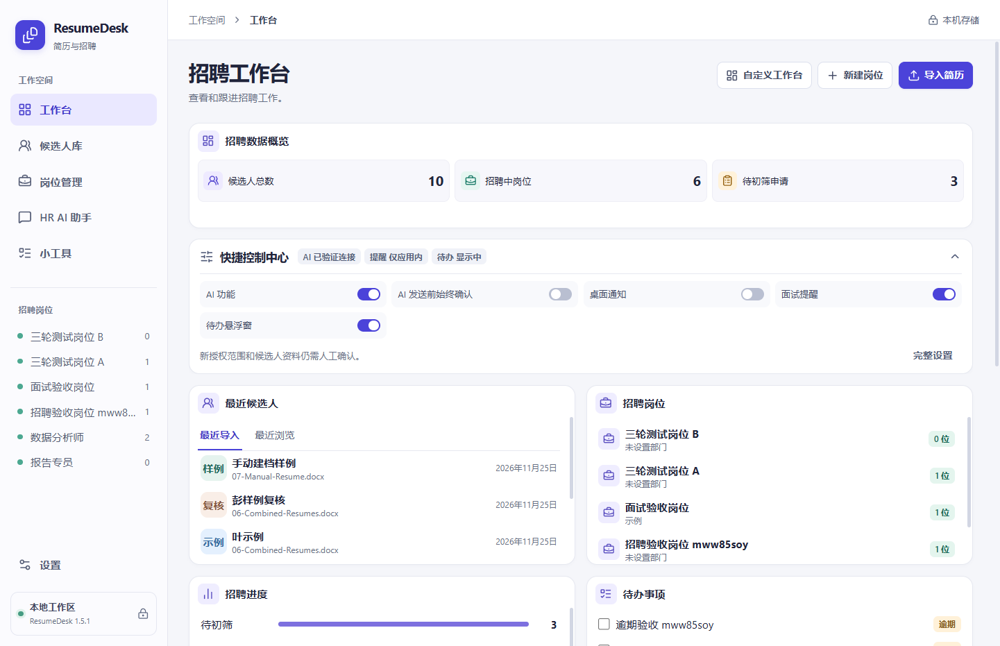
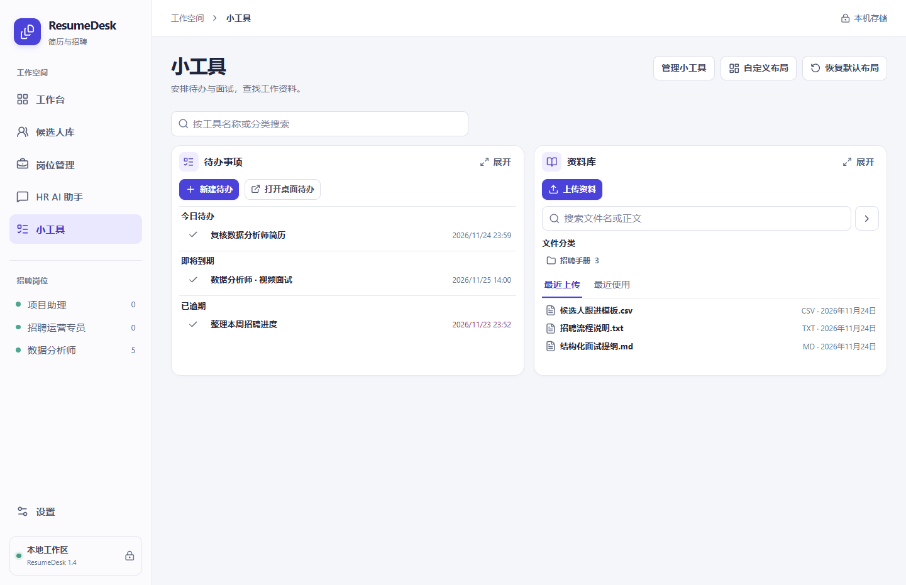

# ResumeDesk

ResumeDesk 是一款面向 HR 和招聘人员的 Windows 本地工作台。它把简历、岗位申请、面试待办和招聘资料放在同一个桌面应用里。基本招聘流程可离线使用，HR AI 助手可按需连接自选模型。

*A local-first recruiting workspace for Windows, with resume search, interview reminders, and an optional AI assistant.*

[界面预览](#界面预览) · [下载 Windows 体验版](https://github.com/Foreman233/ResumeDesk/releases/tag/v1.4.0) · [Windows 验收记录](docs/validation.md)

## 界面预览

工作台集中显示候选人、招聘进展和快捷设置，小工具中心集中管理待办与资料。截图使用虚构演示数据。





## 功能

- **简历与候选人** · 批量导入 PDF、DOCX，预览并搜索正文。导入时可关联岗位，选择自动解析，并在建档前核对从同一文件中识别出的多位候选人。
- **岗位申请** · 管理岗位描述、招聘阶段和 HR 备注。同一位候选人可以有多条独立的岗位申请。
- **工作台与小工具** · 自定义布局和快捷开关。管理待办、安排面试、打开置顶悬浮窗，或在本地资料库搜索文件正文。
- **HR AI 助手** · 使用 OpenAI-compatible API 流式对话。可选择候选人、岗位和资料库片段，在确认发送范围后交给模型，并查看回答中的来源。
- **本地数据** · 通过 SQLite 持久化资料，支持加密备份与恢复。AI 和搜索凭据由 Windows DPAPI 保护。

## 快速体验

1. 在 Windows 10 或 11 x64 上使用 [体验版安装程序](https://github.com/Foreman233/ResumeDesk/releases/download/v1.4.0/ResumeDesk_1.4.0_x64-setup.exe)。1.4.0 安装程序未签名。
2. 在工作台创建一个岗位，从 [`demo/`](demo/) 批量导入示例简历并关联岗位。在候选人库试试按正文搜索和预览 PDF。
3. 在候选人详情安排面试，再打开「小工具 → 打开桌面待办」查看同一条提醒。需要体验 AI 时，可在「设置 → AI 服务」连接自己的模型供应商。

## 从源码运行与构建

准备 Node.js 24、pnpm 11.25.0、Rust stable 的 MSVC 工具链、Visual Studio Build Tools 的「使用 C++ 的桌面开发」工作负载和 Microsoft Edge WebView2 Runtime。具体组件见 [Tauri Windows 前置要求](https://v2.tauri.app/zh-cn/start/prerequisites/)。

在仓库根目录打开 PowerShell。

```powershell
pnpm install --frozen-lockfile
pnpm tauri dev
```

执行 `pnpm tauri build` 生成 EXE 和 NSIS 安装程序，默认输出到 `src-tauri/target/release/` 及其中的 `bundle/nsis/`。仅生成 EXE 时使用 `pnpm tauri build --no-bundle`。

## 开发与测试

| 路径 | 内容 |
| --- | --- |
| [`src/`](src/) | React、TypeScript 和 Vite 桌面界面 |
| [`src-tauri/`](src-tauri/) | Tauri 2、Rust 后端、SQLite 迁移和原生桌面能力 |
| [`tests/`](tests/) | 示例文件和 Windows 桌面验收脚本 |

```powershell
pnpm build
pnpm test
cargo fmt --manifest-path src-tauri/Cargo.toml -- --check
cargo test --locked --manifest-path src-tauri/Cargo.toml
```

[Windows CI](.github/workflows/windows-ci.yml) 会在推送和拉取请求时运行这些检查。原生界面、备份和升级的测试方式及验证范围见 [使用与开发指南](docs/guide.md) 和 [Windows 验收记录](docs/validation.md)。

## 使用范围

当前版本用于 Windows 单机单用户场景。扫描版 PDF 可以预览，文字检索依赖文件里已有的文本层。最小化或留在系统托盘时，应用仍可调度面试提醒。完全退出进程后，提醒停止，未处理提醒会在下次启动时补检。
